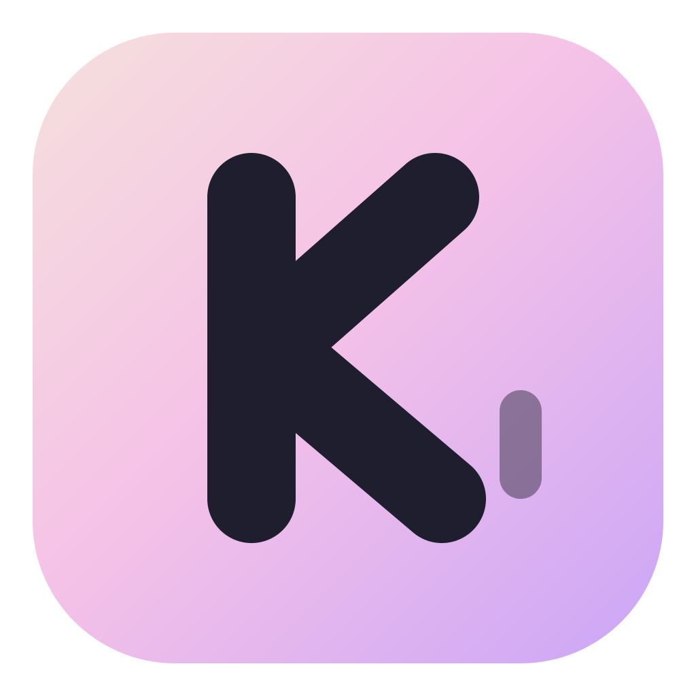
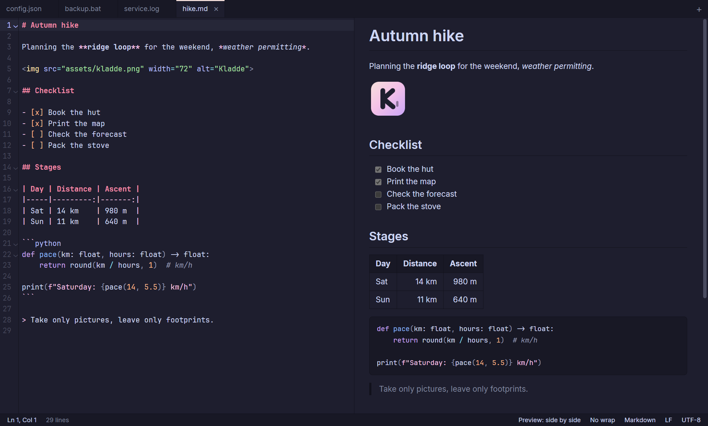

<p align="center">
  
</p>

<h1 align="center">Kladde</h1>

<p align="center">
  A lightweight text editor for Windows: a Notepad++ replacement with first-class Markdown.
</p>

<p align="center">
  
</p>

*Kladde* is German for a rough-draft notebook.

## Motivation

A text editor, simple yet powerful like Notepad++, without becoming an IDE.

So: single files in tabs, no project tree, no Git, no language servers. It opens anything you throw at it,
starts in a fraction of a second, and never loses what you typed.

## Features

**Editing**
- Tabs of single files: open from Explorer, the command line, drag and drop or `Ctrl+O`. A second launch
  hands its files to the running window.
- Syntax highlighting for ~145 languages, detected by extension, file name and shebang line. Grammars load
  on demand; batch files and logs have built-in highlighters too.
- Multiple cursors, column selection (`Alt`+drag), find and replace with regex, go to line, word wrap.
- JSON pretty-print and minify that keep numbers and strings exactly as written.
- Optional spell checking with the Windows dictionaries.

**Markdown**
- Live preview side by side or full size (`Ctrl+Shift+V`), following the editor as you scroll.
- GitHub-flavoured: tables, task lists, autolinks, heading anchors, highlighted code blocks; local images
  resolve relative to the file.
- Paste an image from the clipboard and it is saved next to the file (`assets/` by default) and linked.

**Files**
- Hot exit: closing the window never asks. All tabs, including unsaved changes, come back on the next
  start, even after a crash (backups are written within a second of typing), while the files on disk
  stay untouched until you save.
- Encodings: detects UTF-8, UTF-16 (BOM) and legacy code pages; reopen or save with another encoding;
  keeps CRLF, LF or CR line endings.
- Large files: anything above 32 MB opens in a read-only viewer that indexes lines in the background and
  only reads what is on screen. Multi-GB logs open instantly, with search and go to line.
- External changes: unmodified tabs reload when the file changes on disk, and the active tab follows a
  growing log live; otherwise a banner asks.
- Image viewer for PNG, JPEG, GIF, WebP and more.

**Look**
- [Catppuccin Mocha](https://catppuccin.com) with a Rosewater accent; a light theme is available.
- [JetBrains Mono](https://www.jetbrains.com/lp/mono/) with ligatures in the editor and
  [Inter](https://rsms.me/inter/) for the interface, both bundled.
- Zoom with `Ctrl`+wheel or `Ctrl+Plus` / `Ctrl+Minus`.

## Install

Download the latest version from [Releases](https://github.com/LukasDoubleU/Kladde/releases): the installer
(`…_x64-setup.exe`, installs for the current user without admin rights) or the portable `…_x64_portable.exe`.
Kladde needs Windows 10 or 11 with WebView2, which ships with Windows 11. The files are not code-signed yet,
so SmartScreen may ask for confirmation on the first start. You can also [build it yourself](#building).

## Shortcuts

`Ctrl+Shift+P` (or `F1`) lists every command with its shortcut.

| Keys | Action |
|---|---|
| `Ctrl+N` or `Ctrl+T` / `Ctrl+O` | New tab, open file |
| `Ctrl+S` / `Ctrl+Shift+S` / `Ctrl+Alt+S` | Save, save as, save all |
| `Ctrl+W` / `Ctrl+Shift+T` | Close tab, reopen closed tab |
| `Ctrl+Tab` or `Ctrl+PageDown` / `Ctrl+Shift+Tab` or `Ctrl+PageUp` | Next / previous tab |
| `Alt+Left` / `Alt+Right`, mouse back / forward | Back / forward through recently used tabs |
| `F5` | Reload the file from disk |
| `Alt+Shift+W` | Reveal the file in Explorer |
| `Ctrl+F` / `Ctrl+H` / `F3` | Find, replace, find next |
| `Ctrl+G` | Go to line |
| `Ctrl+D` | Delete the line (or all lines of the selection) |
| `Ctrl+Shift+V` | Markdown preview: side by side, preview only, off |
| `Shift+Alt+F` | Format JSON |
| `Alt+Z` | Toggle word wrap |
| `Ctrl+Plus` / `Ctrl+Minus` / `Ctrl+0` | Zoom in, out, reset |

The defaults work well with mouse gesture tools that send `Ctrl+T`, `Ctrl+W`, `F5` and `Alt+Left` /
`Alt+Right`. To change them, run **Open keyboard shortcuts** from the command palette: it opens
`keybindings.json`, where each command takes a key, a list of keys, or `null` to unbind it:

```json
{
  "file.new": ["Ctrl+N", "Ctrl+T"],
  "view.togglePreview": "Ctrl+K",
  "tab.back": null
}
```

## Settings

**Open settings** in the command palette opens `settings.json`; saving it applies the changes.

| Setting | Default | |
|---|---|---|
| `fontFamily`, `fontSize` | JetBrains Mono, `14` | editor font |
| `fontLigatures` | `true` | ligatures such as `=>` and `!=` |
| `uiFontFamily` | Inter | interface font |
| `theme` | `dark` | `dark` (Catppuccin Mocha), `light` or `system` |
| `tabSize`, `insertSpaces` | `4`, `true` | |
| `wordWrap`, `lineNumbers`, `highlightActiveLine` | `false`, `true`, `true` | |
| `spellCheck` | `false` | can also be toggled from the command palette |
| `markdownPreview` | `split` | how Markdown files open: `split`, `only` or `off` |
| `pasteImageFolder` | `assets` | folder for pasted images, relative to the Markdown file |
| `largeFileThresholdMB` | `32` | larger files open in the read-only viewer |

Settings, keyboard shortcuts, the session and backups of unsaved text live in
`%APPDATA%\io.github.lukasdoubleu.kladde`.

## Building

Requirements: [Node.js](https://nodejs.org) 20+, [Rust](https://rustup.rs) (stable, MSVC toolchain) and the
Visual Studio C++ Build Tools.

```sh
npm install
npm run tauri dev     # run with hot reload
npm run tauri build   # release build and installer
npm run check         # type-check the frontend
cd src-tauri && cargo test
```

## Contributing

Commit messages follow [Conventional Commits](https://www.conventionalcommits.org), e.g.
`feat(preview): render Mermaid diagrams` or `fix: keep the cursor when reloading a file`. `npm install`
sets up a commit-msg hook that checks this, and CI checks it again. Versions follow
[Semantic Versioning](https://semver.org) and are derived from these messages: releases are created on demand
by the Release workflow, which also writes the [changelog](CHANGELOG.md).

## How it works

[Tauri 2](https://v2.tauri.app) with a Rust core for file I/O, encodings, the large file viewer and the
session; [CodeMirror 6](https://codemirror.net) as the editor; [Svelte 5](https://svelte.dev) for the
interface; [markdown-it](https://github.com/markdown-it/markdown-it) and
[DOMPurify](https://github.com/cure53/DOMPurify) for the preview. All open text tabs share one editor
view and keep their own state, including undo history, so switching tabs is instant.

## Roadmap

Planned features and ideas are tracked as [issues](https://github.com/LukasDoubleU/Kladde/issues), among them
text compare, grammar checking with LanguageTool, more formatters, editing large files and custom themes.

## License

[MIT](LICENSE). Kladde bundles JetBrains Mono and Inter under the
[SIL Open Font License](https://openfontlicense.org); the color palette is
[Catppuccin](https://github.com/catppuccin/catppuccin) (MIT).
